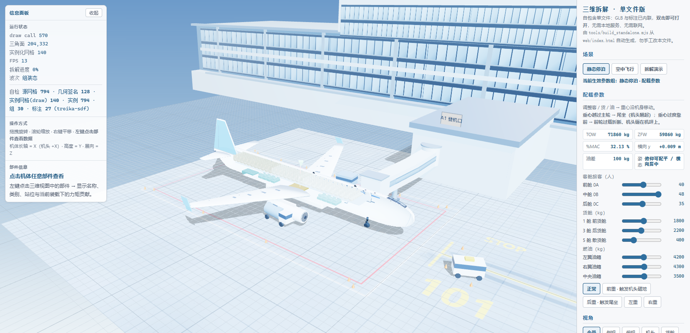
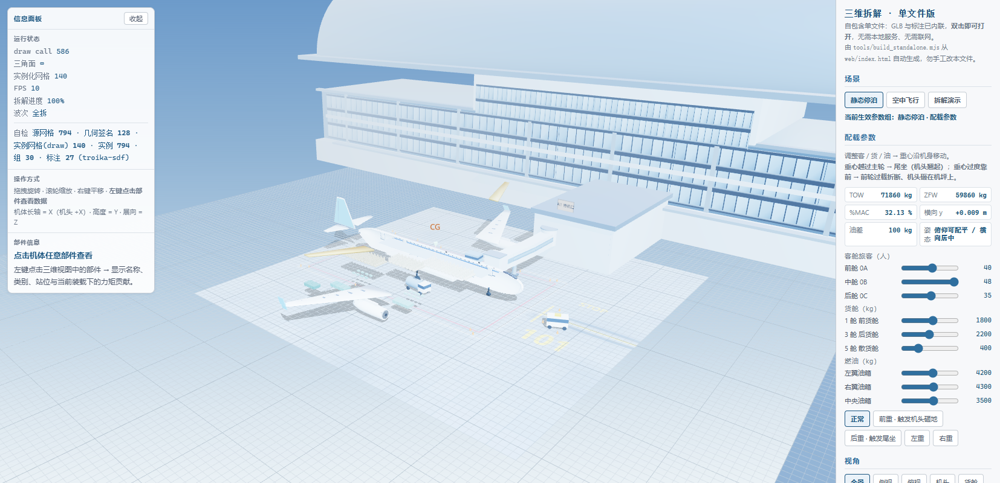
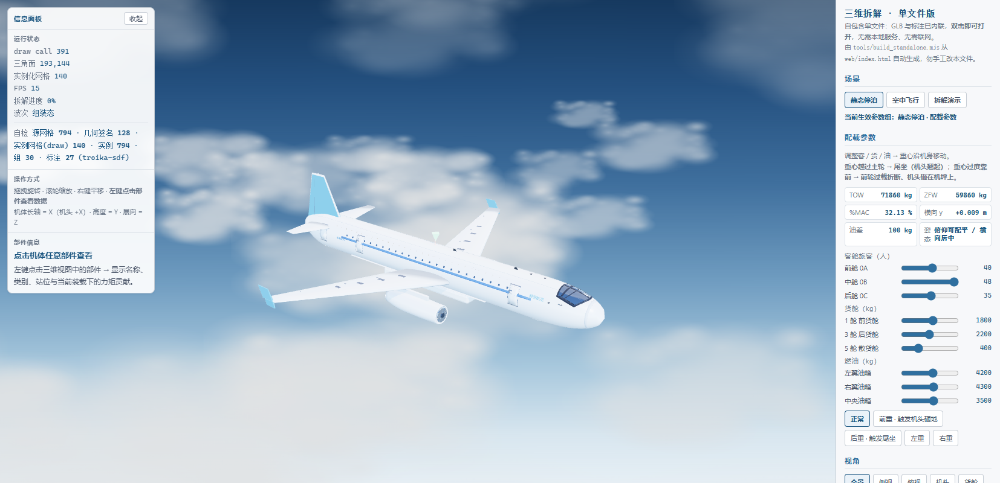
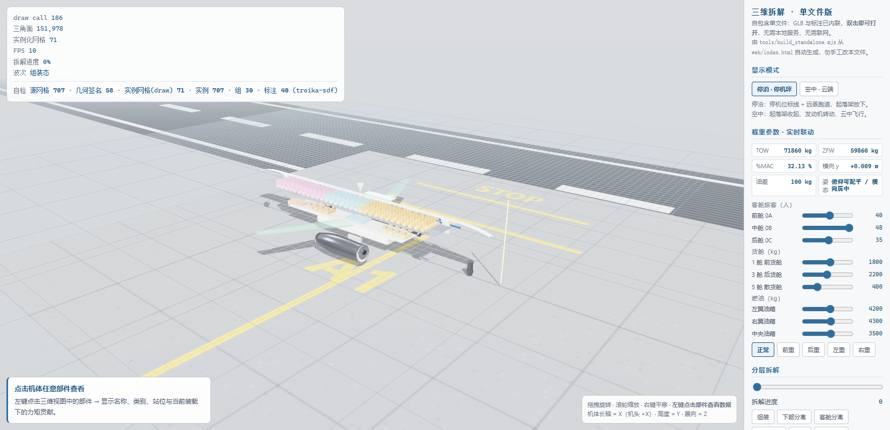
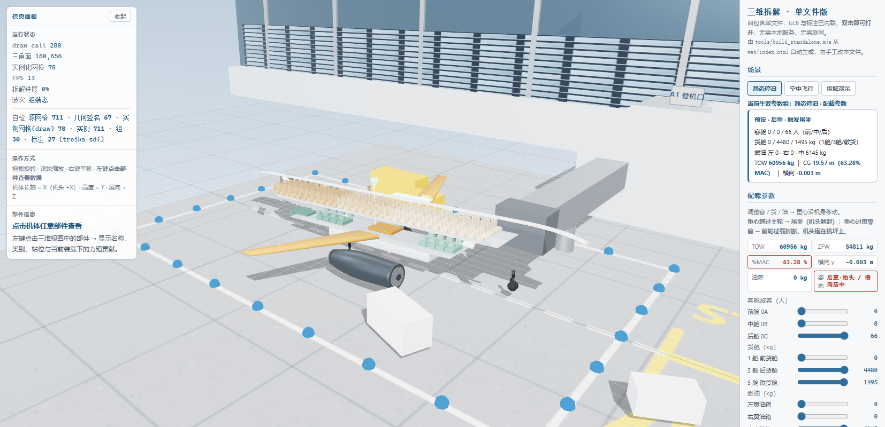
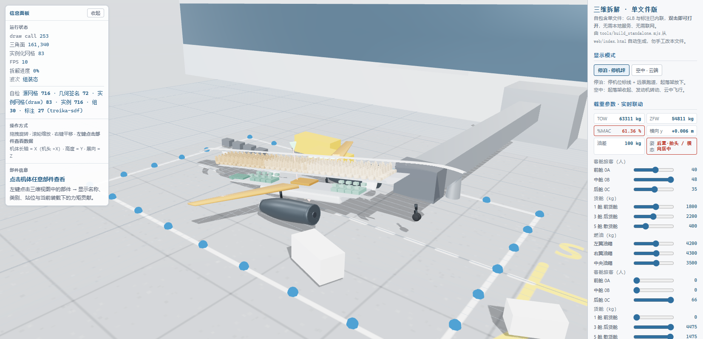

# A320 配载平衡三维教学台 · Weight & Balance Teaching Lab

[](LICENSE)

面向民航配载与地面运行教学的开源课件项目：以 **A320-200** 为载体，把「重量与平衡（Weight & Balance）」这门课从公式和表格，变成**可以拖动、可以拆开、可以看着飞机坐尾巴**的三维交互实验台。

项目包含两件主要成果：

1. **3D 教学模型** —— 参数化建模的 A320（机长 37.57 m / 翼展 34.10 m / 186 座三舱布局），可整体拆解、剖视、标注，配停泊与空中双场景；
2. **配载平衡教学台** —— 单文件网页应用：调旅客/货物/燃油，实时看重心（CG）、%MAC、俯仰与横滚变化，超限时有直观的姿态与事故反馈。

所有交付物**双击即可打开**，无需安装、无需联网——这是为讲台和教室设计的，不是为开发环境设计的。

| | |
|---|---|
|  |  |
|  |  |
|  |  |

---

## 一、交付物

| 文件 | 用途 |
|------|------|
| `output/stage1/配载教学三维拆解.html` | ⭐ **3D 教学台（主交付物）**：单文件、双击即开。三维拆解、剖视、装载预设、%MAC 重心锥、事故演示 |
| `output/配载平衡交互教学.html` | **2D 计算教学页**：俯仰/横滚/静平衡三页签，滑块调参，公式同屏联动 |
| `output/配载平衡教学模型.blend` | **Blender 3D 模型**：A320 外形 + 交互面板（N 面板「配载教学」），可继续编辑与再导出 |
| `output/stage1/web/` | 3D 教学台的 **three.js 源码**（开发版，含本地预览脚本） |
| `scripts/` | 全部建模与导出脚本，`a320_data.py` 是唯一数据源 |
| `docs/` | 机型选型、GLB 元数据契约、外观精修工作流等开发文档 |

## 二、3D 教学台（配载教学三维拆解.html）

直接双击打开（GLB 模型与标注已内联为 base64，经 esbuild 打包为经典脚本，`file://` 协议下可运行，约 4 MB）。

- **装载预设**：正常 / 前重 / 后重 / 左重 / 右重 —— 座椅阵列、货舱货块、油箱随装载点亮，参数卡实时显示各舱重量与重心
- **结构拆解**：客舱座椅（前/中/后三区）、行李舱、货舱、油箱（左/右/中央）、发动机、起落架、尾翼、上壳体逐层拆出，共 28 个拆解组
- **剖视模式**：掀开上壳看客舱 / 货舱 / 油箱布局
- **标注与标尺**：40 条中文标注，机长 / 翼展 / 停机坪标线
- **停泊 / 空中双场景**：停机坪（廊桥、航站楼）与巡航（云层、转动的风扇叶片）
- **超限反馈**：后重超限时的尾坐姿态演示——把「超出后重心限制」从一句话变成一个画面

## 三、2D 计算教学页（配载平衡交互教学.html）

双击打开，页签切换 **俯仰平衡 / 横滚平衡 / 静平衡**：

```
静平衡:  L ≈ W（平飞）   W = OEW + 旅客 + 行李 + 货 + 油
俯仰:    CGx = Σ(W·x)/ΣW        %MAC = (CGx − LEMAC)/MAC × 100
横滚:    CGy = Σ(W·y)/ΣW        （左负右正）
```

滑块：前/中/后舱旅客、前/后/散装货舱、左/右/中央油、货舱横向偏置；预设：正常 / 前重 / 后重 / 左重 / 右重。公式、力臂图与计算结果同屏联动，适合讲解「为什么要分区装载」。

## 四、A320-200 教学数据（ACAP 量级，教学简化）

`scripts/a320_data.py` 是全项目唯一数据源，网页与 Blender 两端都读它：

| 项目 | 值 |
|------|-----|
| 总长 L | 37.57 m |
| 翼展 B | 34.10 m（含翼尖小翼） |
| MAC | 4.1935 m |
| LEMAC FS | 16.92 m（DATUM = 机头） |
| OEW | 42 500 kg |
| MTOW | 78 000 kg |
| 教学包线 | 18% – 36% MAC |
| 客舱布局 | 186Y（3+3）：前舱 1–12 排 / 中舱 13–20 排 / 后舱 21–31 排 |
| 货舱 | 1 / 3 / 4 / 5 号舱 + 散货舱（教学取 1/3/5 主舱） |

## 五、快速开始

**方式一 · 单文件课件（推荐）**

直接双击 `output/stage1/配载教学三维拆解.html`。无任何依赖。

**方式二 · 开发版（可改代码）**

首次使用需还原 npm 依赖（three r186 与交互库不随仓库分发）：

```powershell
# ① 还原构建依赖（three / esbuild）
cd tools && npm install && cd ..\..

# ② 还原网页交互库（camera-controls / three-mesh-bvh / troika-three-text）
cd output\stage1\web\vendor\npm && npm install && cd ..\..

# ③ 把 three.js 本体放回 importmap 指向的位置
robocopy ..\..\..\tools\node_modules\three vendor\three /E

# ④ 启动本地预览
启动预览.cmd        # 起本地 HTTP 服务并打开浏览器
```

**方式三 · Blender 工程**

用 Blender 4.x/5.x 打开 `output/配载平衡教学模型.blend`，按 `N` 调出「配载教学」面板：装载预设、姿态配平动画、装载过程演示（1–100 帧，空机→货→油→客）、结构爆炸。

## 六、从零重建（完整流水线）

依赖：Blender 4.x+（含 Python）、Node.js 18+。

```bash
# 1. Blender 参数化建模（读 a320_data.py）
blender --background --python scripts/build_v6.py

# 2. 元数据契约注入 + GLB 导出（28 拆解组 / lb_group / lb_dir 等契约字段）
blender --background --python scripts/stage1_export.py

# 3. 外观精修（参数化旋成体机身、驾驶舱风挡、短舱/起落架重建、贴面门窗）
blender --background --python scripts/stage2_refine.py

# 4. 单文件课件打包（three.js + GLB base64 内联 → IIFE HTML）
cd tools && npm install && cd ..
node tools/build_standalone.mjs
```

几何契约（`docs/GLB元数据契约.md`）：每个渲染节点携带 `lb_group`（拆解组）、`lb_layer`（拆解层级）、`lb_dir`（拆解方向单位向量）、`lb_anchor`（拆解锚点）四类扩展属性，网页端据此驱动逐层拆解动画；文字不进 GLB（由 `labels.json` + 视图侧渲染承担），几何高度复用（794 网格 / 128 唯一几何）。

## 七、技术栈

- **建模**：Blender bpy 参数化建模（旋成体机身、真翼型放样翼面、186 座椅阵列）
- **渲染**：three.js r186 + three-mesh-bvh + camera-controls + troika-three-text（3D 文字 SDF）
- **打包**：esbuild（ES 模块 → IIFE，`file://` 可运行）
- **交付形态**：零依赖单文件 HTML（内联 Draco 可选 GLB）

## 八、数据与版权说明

- 本项目为**教学项目**：所有配载数据为 ACAP 公开量级的简化值，机型外观为示意性建模，**不含任何真实航司运行数据**，不可用于实际配载计算；
- Airbus ACAP、航司 LOPA 等原始参考资料受版权保护，**不随本仓库分发**，请自行从空客官网等公开渠道获取；
- `output/stage1/preview/` 保存了 150+ 张迭代过程截图（因体积未入库），关键截图见 `docs/images/`。

## 许可证

[MIT](LICENSE) —— 课件、模型、脚本均可自由用于教学与二次开发。
